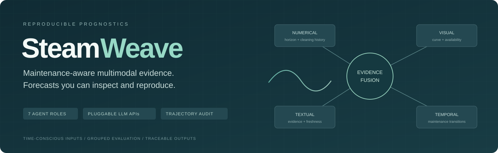
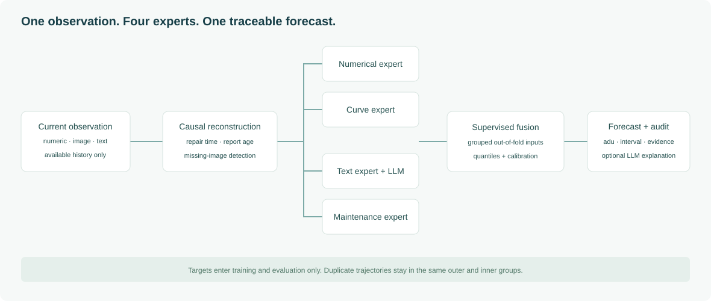
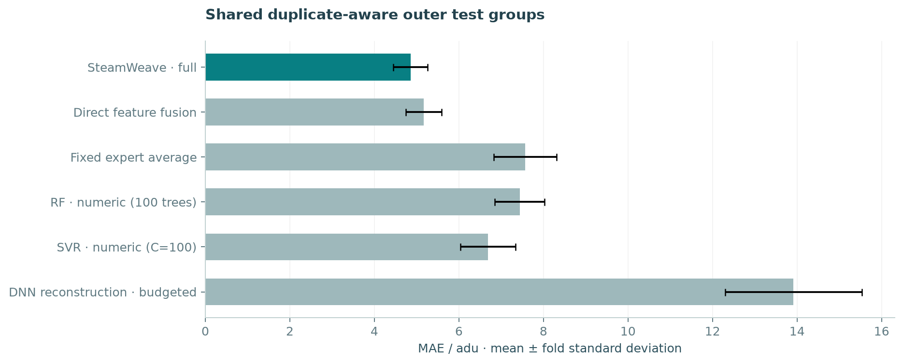

<p align="center"></p>
<p align="center"><a href="README.zh-CN.md">简体中文</a> · <b>English</b> · <a href="docs/TECHNICAL_MANUAL.md">Technical manual</a> · <a href="reports/EXPERIMENTS.md">Experiments</a></p>
<p align="center"><a href="https://github.com/13536309143/SteamWeave/actions/workflows/tests.yml"></a>   </p>

**SteamWeave** is a maintenance-aware multi-agent research workbench for predicting steam-generator degradation at the next planned inspection. The name joins *steam* with *weave*: numerical state, signal images, inspection language and maintenance history form one traceable forecasting workflow.

The repository includes the original simulated dataset, a local web application, modular predictive agents, interchangeable LLM adapters, and completed experiments with predictions and split manifests. Time and degradation use arbitrary units **atu** and **adu**.

## Research highlights

| Capability | Implementation |
| --- | --- |
| Coordinated experts | Numerical, curve, text and maintenance regressors with out-of-fold learned fusion |
| Evidence boundaries | Same-device history available by the observation time; labels excluded from feature construction and LLM input |
| Missing and stale information | Axes-only image detection, explicit masks, observed text-repeat ages and reconstructed repair context |
| Uncertainty | Quantile intervals with held-out inspection-event calibration and empirical coverage reporting |
| API portability | MiniMax, OpenAI GPT, Qwen and custom compatible services; independent extraction/explanation settings |
| Inspectable research | Duplicate-aware splits, six ablations, pressure tests, paired group statistics and a disclosed neural reconstruction budget |

The agents have explicit contracts and a fixed workflow. Predictive experts are supervised models; LLMs extract bounded report semantics and explain evidence. Seven roles do not imply seven paid calls per observation.

## Architecture



The dispatcher bounds available history. Four experts process numerical state, image-derived curve geometry, report features and maintenance context. Fusion learns from expert predictions generated on inner held-out groups. The audit agent exposes quality flags and can request an LLM explanation without sending target labels.

Feature contracts, training, calibration, caching and endpoints: [technical manual](docs/TECHNICAL_MANUAL.md).

## Included dataset

The complete original data is stored in [Multimodal data for prognostics/](Multimodal%20data%20for%20prognostics/), including the upstream `Readme.docx`.

| Property | Audited local copy |
| --- | ---: |
| Device directories / records | 50 / 7,626 |
| Available / missing curves | 6,088 / 1,538 |
| Unique canonical reports | 766 |
| Distinct numerical/time/text trajectory groups | 30 |

Devices 1–20 and 31–50 have paired identical input histories. Primary experiments keep each pair in one partition. This audits the supplied copy, without establishing which data realization the paper used. Original signal arrays and true report-generation timestamps are unavailable; curve geometry and report-repeat ages are derived observations.

Attribution and reuse context: [dataset notice](DATASET_NOTICE.md), [LASAR benchmark](https://www.lasar.polimi.it/?page_id=2970), [associated paper](https://doi.org/10.1016/j.jmsy.2021.01.007).

## Quick start

Tested with Python 3.14 on macOS ARM64. Use Linux, macOS, WSL or the supplied Docker recipe; native Windows file locking is not implemented. Docker has not been validated on the local machine.

```bash
git clone https://github.com/13536309143/SteamWeave.git
cd SteamWeave
python3.14 -m venv .venv
.venv/bin/python -m pip install -r requirements.txt
cp .env.example .env
.venv/bin/python -m sg_agents.cli train --offline --method optimized
.venv/bin/python scripts/service.py start
```

Open **http://127.0.0.1:8787** for the workbench and **http://127.0.0.1:8787/docs** for the API. The default offline pipeline uses the included frozen MiniMax semantic asset. New uncached reports and live explanations need a configured key. Model files are regenerated locally.

```bash
.venv/bin/python scripts/service.py restart
.venv/bin/python scripts/service.py stop
.venv/bin/python -m pytest -q
```

The workbench supports observation selection, point predictions and intervals, missing-modality switches, history charts, custom numeric/text/image uploads, CSV export, training and supplier-selectable explanations.

## Configure your API

Add applicable variables from [config/](config/) to your private `.env`. Keys remain on the backend and are excluded from Git.

| Provider | Key variable | Example | Validation |
| --- | --- | --- | --- |
| MiniMax | `MINIMAX_API_KEY` | [MiniMax](config/minimax.env.example) | Real API requests validated |
| OpenAI GPT | `OPENAI_API_KEY` | [OpenAI](config/openai.env.example) | Mocked protocol/error tests; live key required |
| Qwen | `DASHSCOPE_API_KEY` | [Qwen](config/qwen.env.example) | Mocked protocol/error tests; live key required |
| Custom compatible service | `CUSTOM_API_KEY` | [Custom](config/custom.env.example) | Mocked protocol/error tests; deployment-specific live verification required |

`LLM_PROVIDER` selects extraction; `LLM_AUDIT_PROVIDER` independently selects explanation. Chat Completions and Responses formats support configurable models, endpoints and output-token parameters. The adapter never substitutes another supplier's key.

```dotenv
LLM_PROVIDER=minimax
LLM_AUDIT_PROVIDER=openai
OPENAI_API_KEY=replace_with_your_key
OPENAI_MODEL=your-gpt-model
```

```bash
.venv/bin/python -m sg_agents.cli check-api --provider openai
# Changing extraction requires rebuilding features and retraining.
.venv/bin/python -m sg_agents.cli train --provider qwen
```

Changing only explanation preserves the predictive model. Extraction caches are isolated by provider/model/endpoint/protocol. Qwen regional endpoints must match the key. See [API configuration details](docs/TECHNICAL_MANUAL.md#8-api-suppliers-credentials-and-cache-provenance).

## v2 optimization results

Added **18 outer evaluations**, each comparing eight fixed candidates with three inner folds inside the fitting period. The new head describes curve shape, adds repair-reset historical curves and change rates, and allows absolute-error models to compete. Missing current curves use the original augmented expert fusion.

| Scenario | Original MAE / adu | Optimized MAE / adu |
| --- | ---: | ---: |
| Five grouped folds × three seeds | 4.853 ± 0.405 | **4.089 ± 0.314** |
| Serving model's fixed holdout | 5.094 | **4.077** |
| Future-period candidate, three runs | **11.140** | 11.501 ± 0.029 |

Grouped MAE decreases by **15.7%** and the serving holdout error by **20.0%**. The temporal candidate does not improve, so the original temporal checkpoint is retained. Optimized intervals are wider: grouped mean width 35.072 adu versus 28.818 adu originally. With all current curves masked, point predictions equal the original method; previously observed history remains available.

This is exploratory development on an examined benchmark. The availability gate was added after initial missing-curve diagnostics; it is not a new blind test or a matched-condition superiority claim over the paper. Candidate/parameter selection stays inside fitting data and targets never enter prediction features. See the [v2 report](reports/optimization/OPTIMIZATION.md), [fold metrics](reports/optimization/fold_metrics.csv) and [inner selection audits](reports/optimization/selection_audits.json).

Original expert outputs remain diagnostic. Available curves use the new prediction head; missing curves use original expert fusion. Run `python -m sg_agents.cli optimize --offline` to upgrade an existing matching checkpoint, or follow the quick start to train from scratch. Restore v1 with `python -m sg_agents.cli train --offline --method legacy`.

## Original complete benchmark

**23 outer evaluations · 151 model evaluations · 300 pressure conditions · 6 neural fits.** Grouped CV uses five folds and three seeds; six ablations and pressure tests cover all five grouped folds of seed 17. Neural reconstruction uses one seed.

| Model | Grouped CV MAE / adu | Evaluations |
| --- | ---: | ---: |
| SteamWeave full | **4.853 ± 0.405** | 15 |
| Direct feature fusion | 5.173 ± 0.423 | 15 |
| Fixed expert average | 7.569 ± 0.740 | 15 |
| Numerical RF, 100 trees | 7.441 ± 0.588 | 15 |
| Numerical SVR, C=100 | 6.688 ± 0.650 | 15 |
| Budgeted three-branch DNN reconstruction | 13.914 ± 1.617 | 5 |

Values are fold means ± sample standard deviations, not confidence intervals. The neural baseline has fewer seeds and a disclosed 80-epoch cap with validation early stopping.



The future-period test produces **11.140 adu MAE**, showing a temporal-generalization gap. Removing the current text expert improves error on the tested seed; LLM semantics show no clear benefit. Architectural roles do not establish predictive value. These ablations retain earlier timing/maintenance context and have not silently replaced production settings.

The [2021 paper](https://doi.org/10.1016/j.jmsy.2021.01.007) reports MAE 3.20 adu under its own protocol. We retain that as a literature reference and run a disclosed structure reconstruction on shared local partitions. Data and implementation differences prevent an exact-reproduction or cross-paper superiority claim. Directory-ID splitting is separately diagnostic because duplicate histories can cross partitions.

Experiments include 0–100% curve/text/both loss, contiguous outages, report delays, maintenance/horizon slices, interval coverage, group bootstrap intervals and paired ablations with Holm correction.

| Artifact | Link |
| --- | --- |
| Bilingual experiment report | [English](reports/EXPERIMENTS.md) · [中文](reports/EXPERIMENTS.zh-CN.md) |
| Fixed protocol and budget | [Protocol](docs/EXPERIMENT_PROTOCOL.md) · [Manifest](reports/experiment_manifest.json) |
| Metrics and statistics | [CSV](reports/fold_metrics.csv) · [Summary](reports/summary.json) · [Paired analysis](reports/paired_analysis.json) |
| Predictions and partitions | [Compressed CSV](reports/predictions.csv.gz) · [Split manifests](reports/run_manifests/) |
| Stress and neural training | [Pressure metrics](reports/pressure_tests.json) · [Epoch histories](reports/neural_training_histories.json) |
| Exportable figures | [PNG and editable SVG](reports/figures/) |

## Reproduce and extend

```bash
.venv/bin/python -m pip install -r requirements-research.txt
.venv/bin/python -m research.run_suite
.venv/bin/python -m research.extend_stress
.venv/bin/python -m research.summarize
```

The vocabulary-specific GloVe asset is included; `python -m research.glove` regenerates it from the official source. Runs write to ignored `artifacts/research/`, separate from the serving model. Completed runs resume only with matching configuration. Use a new `--run-name` when changing budgets; see the [manual](docs/TECHNICAL_MANUAL.md#10-research-commands-and-comparison-scope).

## Documentation and attribution

- Technical manuals: [English](docs/TECHNICAL_MANUAL.md) · [中文](docs/TECHNICAL_MANUAL.zh-CN.md).
- [Contribution guide](CONTRIBUTING.md), [security notes](SECURITY.md), [citation metadata](CITATION.cff).
- [Dataset attribution](DATASET_NOTICE.md) and [GloVe/semantic asset notice](research/assets/NOTICE.md).

Yang, Z., Baraldi, P., & Zio, E. (2021). *A multi-branch deep neural network model for failure prognostics based on multimodal data*. Journal of Manufacturing Systems, 59, 42–50. [DOI](https://doi.org/10.1016/j.jmsy.2021.01.007).

SteamWeave studies a synthetic benchmark with thirty distinct input-trajectory groups. Results describe this implementation and data copy; independent industrial validation remains future work.
