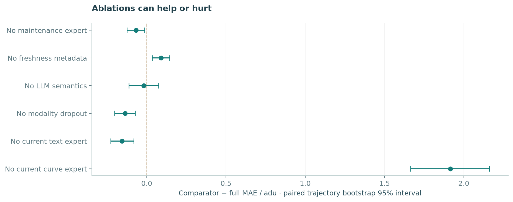
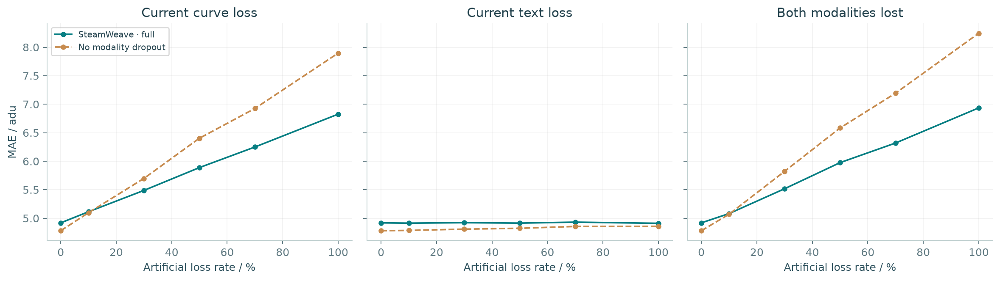
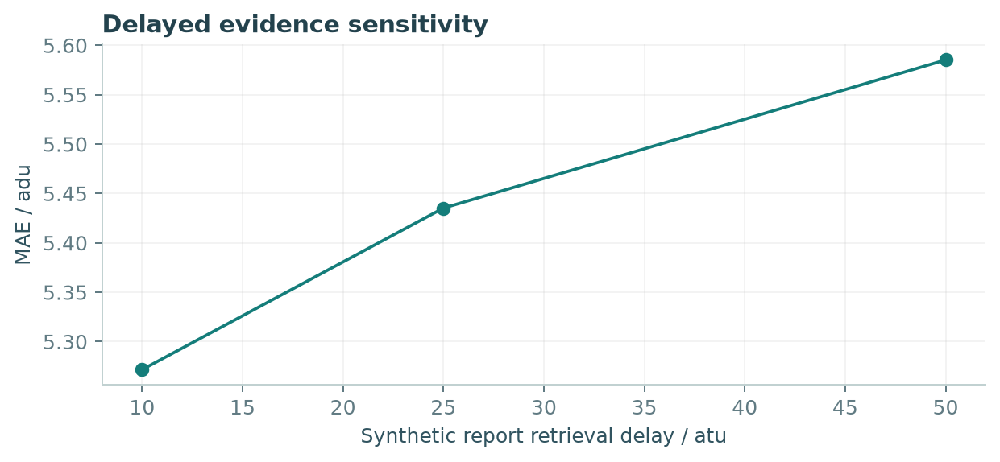
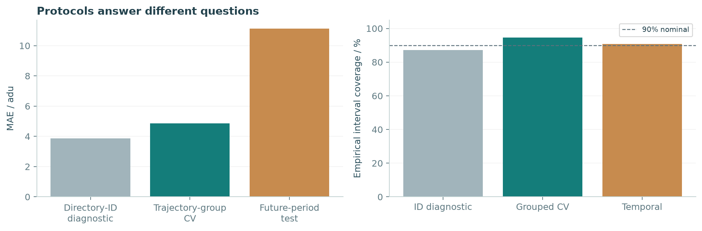

# SteamWeave 实验报告

[English](EXPERIMENTS.md) · [实验协议](../docs/EXPERIMENT_PROTOCOL.md) · [原始指标](fold_metrics.csv) · [配对预测](predictions.csv.gz)

## 范围与结果来源

实际完成 **23 次外层评估、151 个模型评估、300 个压力测试条件、6 次深度网络拟合**。轨迹组与时间实验的监督模型采用 17/41/73 三个种子；深度重建仅使用种子 17。六项消融和压力测试覆盖种子 17 的完整五折。下表标准差表示折/运行差异，不是置信区间。

原论文三分支模型报告 MAE 3.20 adu、MSE 45.57 adu²、MRE 6.76%（[表 3](https://www.researchgate.net/publication/349102644_A_multi-branch_deep_neural_network_model_for_failure_prognostics_based_on_multimodal_data)）。此文献值不并入本地模型排名：原始划分、数据实现、优化和硬件未完整匹配。本地 DNN 为已披露训练选择的结构重建，不是作者检查点。

## 主要轨迹组比较

| Model | MAE / adu | MSE / adu² | MRE / % | Folds / runs |
| --- | ---: | ---: | ---: | ---: |
| SteamWeave · full | 4.853 ± 0.405 | 49.469 ± 9.868 | 8.742 ± 0.737 | 15 |
| Direct feature fusion | 5.173 ± 0.423 | 52.163 ± 9.903 | 9.201 ± 0.680 | 15 |
| Fixed expert average | 7.569 ± 0.740 | 94.550 ± 18.685 | 15.271 ± 1.318 | 15 |
| RF · numeric (100 trees) | 7.441 ± 0.588 | 110.160 ± 19.143 | 13.260 ± 1.050 | 15 |
| SVR · numeric (C=100) | 6.688 ± 0.650 | 87.704 ± 20.011 | 11.691 ± 1.125 | 15 |
| DNN reconstruction · budgeted | 13.914 ± 1.617 | 333.024 ± 61.000 | 29.357 ± 4.038 | 5 |

完整系统折平均 MAE 为 **4.853 adu**，轨迹组宏平均 MAE 为 4.793 adu。模型使用同一留出轨迹组与开发边界；深度重建为五次拟合，三种子系统/传统基线为十五次。

## 消融与配对不确定性

| Model | MAE / adu | MSE / adu² | MRE / % | Folds / runs |
| --- | ---: | ---: | ---: | ---: |
| SteamWeave · full | 4.919 ± 0.465 | 50.583 ± 11.977 | 8.843 ± 0.865 | 5 |
| No maintenance expert | 4.856 ± 0.427 | 49.070 ± 10.732 | 8.713 ± 0.814 | 5 |
| No freshness metadata | 5.011 ± 0.471 | 51.957 ± 11.471 | 9.056 ± 0.979 | 5 |
| No LLM semantics | 4.894 ± 0.433 | 50.568 ± 11.503 | 8.818 ± 0.770 | 5 |
| No modality dropout | 4.781 ± 0.445 | 48.372 ± 10.958 | 8.650 ± 0.925 | 5 |
| No current text expert | 4.742 ± 0.459 | 47.942 ± 10.722 | 8.573 ± 0.882 | 5 |
| No current curve expert | 6.869 ± 0.707 | 90.729 ± 18.160 | 12.086 ± 1.515 | 5 |

| Comparator removed | Δ MAE / adu | Bootstrap 95% | Holm p |
| --- | ---: | --- | ---: |
| No maintenance expert | -0.068 | [-0.125, -0.014] | 0.0853 |
| No freshness metadata | 0.090 | [0.034, 0.144] | 0.01733 |
| No LLM semantics | -0.019 | [-0.113, 0.074] | 0.8078 |
| No modality dropout | -0.137 | [-0.203, -0.074] | 0.001416 |
| No current text expert | -0.155 | [-0.227, -0.081] | 0.001416 |
| No current curve expert | 1.916 | [1.663, 2.161] | 1.118e-08 |

正差值表示移除模块使误差增加；负差值表示简化方案更好。置信区间按三十个轨迹组重采样，符号秩检验基于逐组配对误差，六项消融使用 Holm 校正。统计推断依赖轨迹组作为抽样单位的合理性，不能外推为真实工业结论。

当前报告内容和 LLM 语义不预设准确率收益。无当前文本专家仍保留原始数值、过去时间与维护上下文，不能解读为删除全部文本历史。系统不会根据测试集排名自动替换界面模型。

## 缺失证据与报告延迟

完整模型与无模态增强模型使用配对缺失掩码。当前曲线、文本、两者同时缺失覆盖 0–100%；连续曲线中断覆盖每台设备测试记录末段的 30/50/70%。自然缺失、旧文本、新维修、预测跨度分组见 [pressure_tests.json](pressure_tests.json)。

10/25/50 atu 延迟只读取较早观察的文本，并调整观测年龄。这属于合成扰动。本地审计未发现自然的“连续沿用文本之后发生维修”样本，因此不声称这种交互已通过自然样本验证。

## 未来时段与设备 ID 诊断

| Model | MAE / adu | MSE / adu² | MRE / % | Folds / runs |
| --- | ---: | ---: | ---: | ---: |
| SteamWeave · full | 11.140 ± 0.000 | 187.207 ± 0.000 | 13.246 ± 0.000 | 3 |
| Direct feature fusion | 11.755 ± 0.000 | 217.475 ± 0.000 | 14.253 ± 0.000 | 3 |
| Fixed expert average | 20.069 ± 0.000 | 635.077 ± 0.000 | 21.588 ± 0.000 | 3 |
| RF · numeric (100 trees) | 14.722 ± 0.041 | 297.460 ± 0.853 | 17.623 ± 0.061 | 3 |
| SVR · numeric (C=100) | 22.078 ± 0.000 | 893.094 ± 0.000 | 24.473 ± 0.000 | 3 |
| DNN reconstruction · budgeted | 21.019 ± 0.000 | 656.058 ± 0.000 | 23.294 ± 0.000 | 1 |

时间外推 MAE 为 **11.140 adu**。完整模型三个种子的点预测相同，原因是固定时间分区上的直方图学习器为确定性实现；三次运行不等于三个独立数据集。

| Model | MAE / adu | MSE / adu² | MRE / % | Folds / runs |
| --- | ---: | ---: | ---: | ---: |
| SteamWeave · full | 3.856 ± 0.264 | 31.503 ± 4.290 | 6.925 ± 0.459 | 5 |
| Direct feature fusion | 3.711 ± 0.454 | 27.827 ± 7.500 | 6.736 ± 0.707 | 5 |
| Fixed expert average | 5.860 ± 0.517 | 58.440 ± 10.435 | 11.517 ± 1.124 | 5 |
| RF · numeric (100 trees) | 5.869 ± 0.637 | 72.386 ± 14.243 | 10.671 ± 1.008 | 5 |
| SVR · numeric (C=100) | 6.576 ± 0.684 | 85.929 ± 16.626 | 11.502 ± 0.982 | 5 |

设备 ID 诊断 MAE 为 **3.856 adu**。这个协议可能让重复轨迹跨越训练与测试，随机记录验证也不同于轨迹组开发边界。较低误差不属于独立性受控的泛化结果，也不等同于原论文数据实现的数值复现。

覆盖率为实测值，区间宽度保存在 JSON/CSV 中。按事件校准不消除观测之间的相关性。拟合时间排除一次性 API/特征准备，不据此声称相对原论文 CPU 实验的跨硬件加速比。

## 深度重建的预算

图像、TextCNN、数值分支尺寸来自已核对的结构说明；优化器、预处理和计划等补充选择保存于训练历史。6 次拟合中，**1 次到达 80 轮上限**，并在该预算内按验证集选最佳检查点。这衡量当前实现与预算，不代表论文方法经充分优化后的性能上限。更多深度随机种子与更高预算仍属于后续工作。

## 复现材料

- [固定配置](experiment_manifest.json)、[数据审计](data_audit.json)、[文献参考](paper_reference.json)。
- [汇总](summary.json)、[逐折指标](fold_metrics.csv)、[配对分析](paired_analysis.json)。
- [全部未扰动配对预测](predictions.csv.gz)、[外层与内层划分](run_manifests/)。
- [压力条件与指标](pressure_tests.json)、[深度训练轮次记录](neural_training_histories.json)。
- [figures/](figures/) 中包含 PNG 与可编辑 SVG。

## 解释范围

模态可用性、文本时间、维护上下文和划分方法需要分别研究。架构中的职责不等于预测收益的证明。本实验为含重复轨迹的模拟基准提供可复核比较，不声称真实工业精度或对文献方法的普遍优越性。
