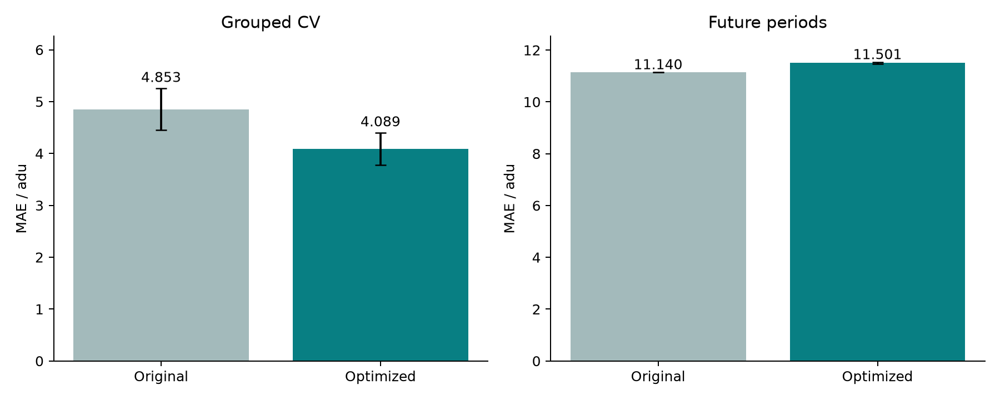

# SteamWeave v2 optimization / 优化报告

[English](OPTIMIZATION.md) · [中文](OPTIMIZATION.zh-CN.md)

This is an exploratory follow-up on the previously examined synthetic benchmark. Eight candidates were fixed before new outer predictions. Three inner folds select features/model/loss using only outer fitting rows. Outer calibration labels determine interval width only. Candidate selection never receives outer test labels. The current-curve availability gate was added after exploratory missing-curve diagnostics; this is not an untouched test-set study.

| Protocol / 协议 | Original MAE / 原 MAE | Optimized MAE / 优化 MAE | Runs / 运行 |
| --- | ---: | ---: | ---: |
| Grouped CV | 4.853 ± 0.405 | 4.089 ± 0.314 | 15 |
| Future periods | 11.140 ± 0.000 | 11.501 ± 0.029 | 3 |

Across grouped folds, MSE changes from 49.469 to 39.073 adu² and MRE from 8.742% to 7.036%. Mean interval coverage changes from 94.6% to 97.2%, with wider intervals: 28.818 to 35.072 adu. Temporal MSE worsens from 187.207 to 222.680 adu². Those tradeoffs are retained in the report rather than hidden by the MAE improvement.



Changes: quadratic curve descriptors; strictly earlier same-device curve state and change rates; reset history after observed repair; explicit horizon interactions; grouped/forward inner model selection; absolute-error objective among the candidates. The optional semantic view competes with simpler views rather than being forced into every prediction. An available current curve uses the selected head; a missing current curve uses the original augmented expert fusion. The availability gate depends on input availability, not target values.

Paired group delta (optimized − original): **-0.741 adu**, bootstrap 95% **[-0.915, -0.573]**. Negative means improvement / 负值表示改善。

Limitations: no independent new dataset; thirty groups; fold variation is not a confidence interval; temporal repetitions are the same fixed split; the temporal candidate worsened results, so the serving future-period checkpoint remains the original method; no claim of exceeding the paper on matching conditions. History cannot recover an unobserved repair or original signal values. Pressure tests mask the current modality only and retain previously observed curve history.

[Summary / 汇总](summary.json) · [Fold metrics / 折指标](fold_metrics.csv) · [Paired predictions / 配对预测](predictions.csv.gz) · [Inner selections / 内层选择](selection_audits.json) · [Pressure / 压力](pressure_tests.json) · [Manifest / 配置](manifest.json)

```bash
.venv/bin/python -m research.optimize run
.venv/bin/python -m research.optimize summarize
```
